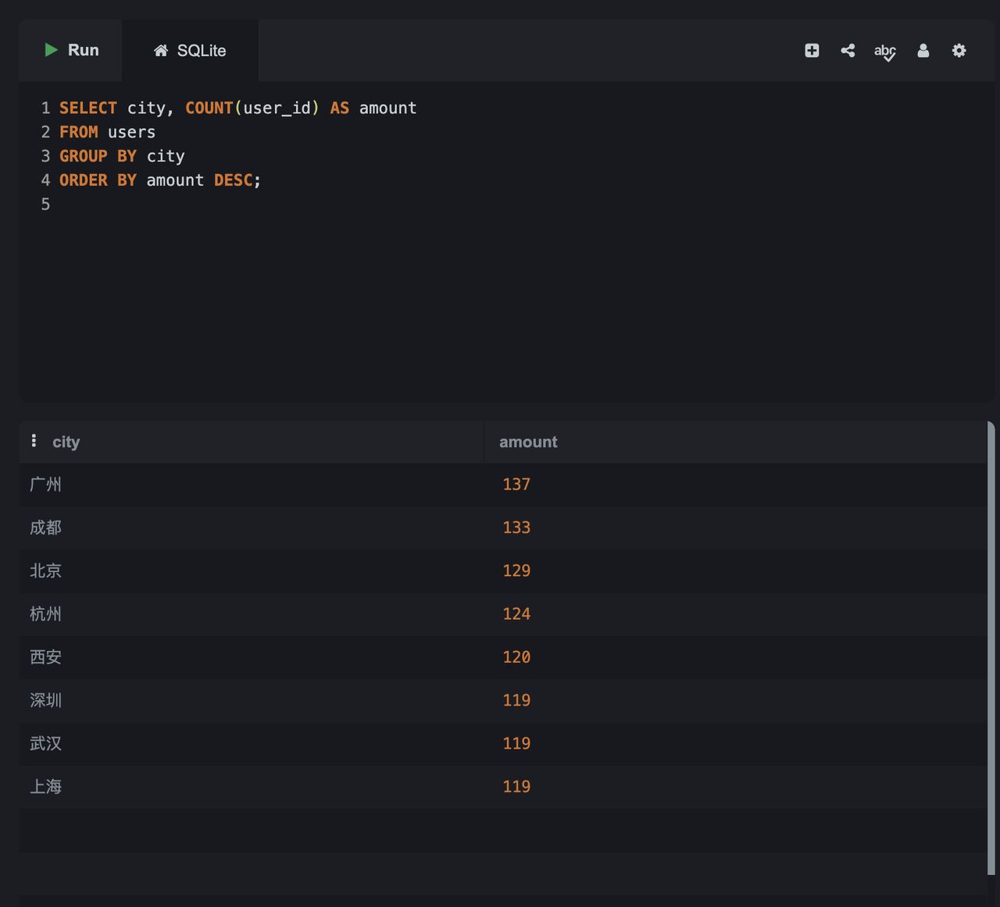
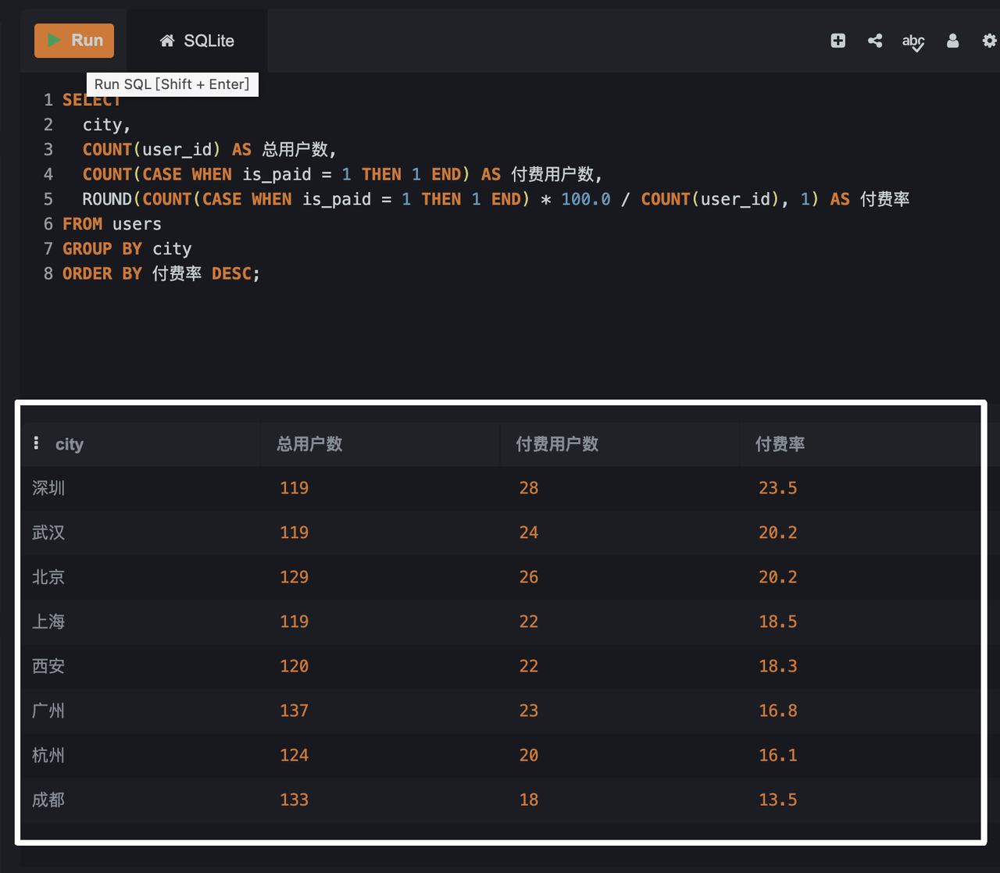
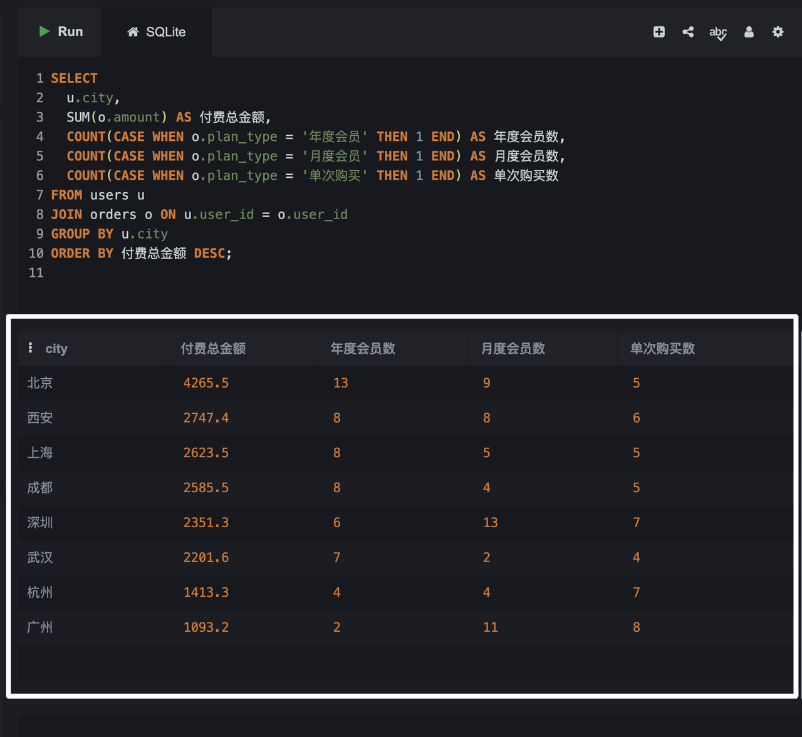
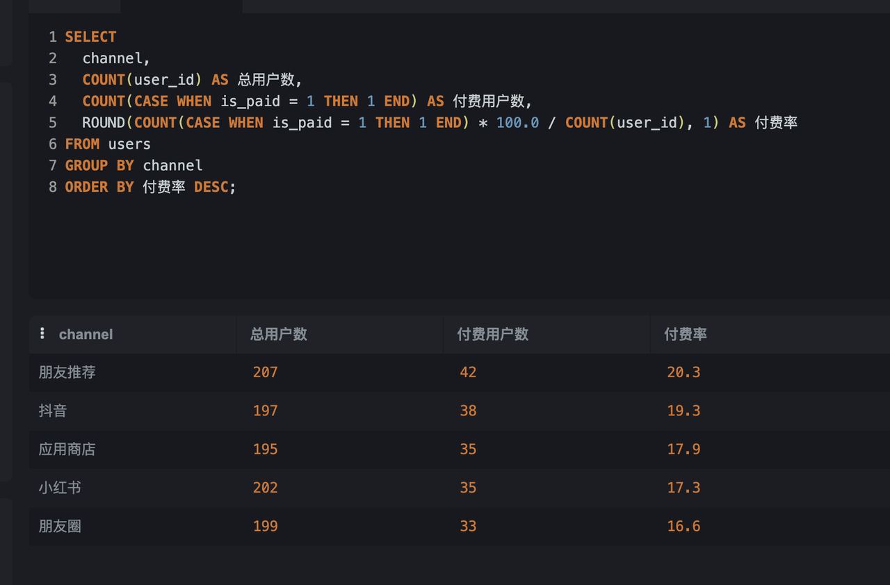
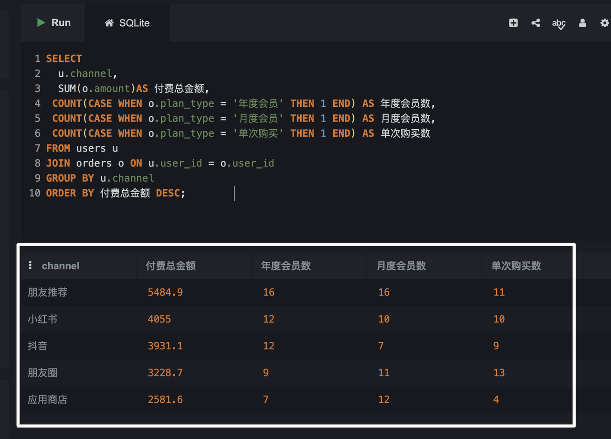

# 用户从哪来

业务案例问题：用户主要从哪里来？

问题拆分：

-> 需要的字段

**1/ 城市分布维度：** users 表的 city 字段

**2/ 获客渠道维度：** users 表的 channel 字段

---

## 城市分布维度

### 第一层：基础分布

各城市有多少用户，哪个城市用户最多？

```sql
SELECT city, COUNT(user_id) AS amount
FROM users
GROUP BY city
ORDER BY amount DESC;
```

> 翻译：从users表里，把用户按城市分组，数每组有多少人，然后从多到少排列显示出来。



**数据直觉训练：**

1. 方差不大，说明这个产品的用户地域分布比较均匀，没有明显「大本营城市」。这在真实产品里不常见，大多数产品早期会有一个强势城市。

2. 只有8个城市，这是因为 AI 生成模拟数据时预设了8个城市。真实产品数据里可能有几百个城市，甚至有海外城市，长尾数据很多。

---

### 第二层：转化能力

各城市用户里，付费率是多少？哪个城市的用户付费意愿最强？

```sql
SELECT 
  city,
  COUNT(user_id) AS 总用户数,
  COUNT(CASE WHEN is_paid = 1 THEN 1 END) AS 付费用户数,
  ROUND(COUNT(CASE WHEN is_paid = 1 THEN 1 END) * 100.0 / COUNT(user_id), 1) AS 付费率
FROM users
GROUP BY city
ORDER BY 付费率 DESC;
```



**数据直觉训练：**

总用户数才1000，说明产品处于内测或刚上线阶段。付费率中位数接近20%，不符合实际规律，太高了。

真实SaaS产品免费转付费率通常是：
- 一般水平：2%-5%
- 优秀水平：5%-10%
- 20% → 强付费墙产品

> **重要原则：** 数据分析的结论，永远要结合行业基准来判断，不能只看数字本身。第一反应应该是：数字是不是统计口径有问题？比如 is_paid 的定义是不是包含了试用期、内部账号等。

**延伸概念：强付费墙 vs 弱付费墙（Freemium）**

| 类型 | 免费用户 | 付费用户 | 典型产品 | 付费转化率 |
|------|----------|----------|----------|------------|
| 强付费墙 | 只能试用几次或无法使用 | 才能正常使用 | 部分专业软件、AI工具 | 15%-30% |
| 弱付费墙 | 能用基础功能 | 解锁更多功能或用量 | Notion、Spotify、Dropbox | 2%-8% |

**AI功能付费策略参考：**
- 付费墙前 → 吸引注册
- 付费墙后 → 驱动付费转化

---

### 第三层：城市×付费行为的交叉分析

各城市的付费金额和套餐偏好？

```sql
SELECT 
  u.city,
  SUM(o.amount) AS 付费总金额,
  COUNT(CASE WHEN o.plan_type = '年度会员' THEN 1 END) AS 年度会员数,
  COUNT(CASE WHEN o.plan_type = '月度会员' THEN 1 END) AS 月度会员数,
  COUNT(CASE WHEN o.plan_type = '单次购买' THEN 1 END) AS 单次购买数
FROM users u
JOIN orders o ON u.user_id = o.user_id
GROUP BY u.city
ORDER BY 付费总金额 DESC;
```



**语法说明：**

- `u.` 和 `o.` 是表的别名前缀，当两张表都有同名字段时，用来区分"这个字段来自哪张表"
- `SUM(o.amount)` 是求和函数，把同一城市所有订单金额加起来
- `FROM users u` → 以users为主表，简称u；`JOIN orders o` → 把orders表拼进来，简称o

**SQL书写顺序 vs 执行顺序：**

| 书写顺序 | 执行顺序 | 作用 |
|----------|----------|------|
| 1. SELECT | 4 | 决定显示哪些列 |
| 2. FROM | 1 | 确定数据来源 |
| 3. JOIN | 2 | 拼接其他表 |
| 4. WHERE | 3 | 筛选行 |
| 5. GROUP BY | 5 | 分组 |
| 6. HAVING | 6 | 筛选分组结果 |
| 7. ORDER BY | 7 | 排序 |
| 8. LIMIT | 8 | 截取行数 |

> COUNT/SUM/ROUND/CASE WHEN 不在这个顺序里，因为它们是函数，不是执行阶段。写在SELECT里就在第4步执行，写在HAVING里就在第6步执行。

---

## 获客渠道维度

主要指标 → 质量（付费率、客单价）

辅助指标 → 潜力（近期付费趋势）

### 第一层：渠道用户质量

哪个获客渠道带来的用户付费率最高？

```sql
SELECT 
  channel,
  COUNT(user_id) AS 总用户数,
  COUNT(CASE WHEN is_paid = 1 THEN 1 END) AS 付费用户数,
  ROUND(COUNT(CASE WHEN is_paid = 1 THEN 1 END) * 100.0 / COUNT(user_id), 1) AS 付费率
FROM users
GROUP BY channel
ORDER BY 付费率 DESC;
```



### 第二层：渠道付费金额与套餐偏好

```sql
SELECT                                  
  u.channel,                                  
  SUM(o.amount) AS 付费总金额,                           
  COUNT(CASE WHEN o.plan_type = '年度会员' THEN 1 END) AS 年度会员数,   
  COUNT(CASE WHEN o.plan_type = '月度会员' THEN 1 END) AS 月度会员数,
  COUNT(CASE WHEN o.plan_type = '单次购买' THEN 1 END) AS 单次购买数
FROM users u                           
JOIN orders o ON u.user_id = o.user_id 
GROUP BY u.channel                         
ORDER BY 付费总金额 DESC;    
```



**数据解读：**

- 朋友推荐付费率最高，说明产品依赖口碑自传播，且口碑渠道的用户付费意愿更强
- 抖音、小红书、应用商店、朋友圈付费率相差不大，但这几个渠道的投放逻辑差异较大，结果趋同值得深究
- 「朋友圈」渠道定义存疑：需确认是平台广告还是用户自发传播，若数据来源是用户问卷，存在混淆风险，会影响结论可信度
- 若抖音/小红书是广告投放主阵地但付费率并不突出，需重新评估投放策略的ROI

> **量效平衡：** 付费率高不等于渠道价值高，还需结合渠道带来的用户总量来看。高转化低体量 vs 低转化高体量，哪个更值得加大投入，要算绝对贡献而非只看比率。

---

## 本案例涉及的SQL语法

| 语法 | 作用 | 本案例使用场景 |
|------|------|----------------|
| SELECT + FROM | 查询指定字段 | 选取city、channel、user_id等字段 |
| COUNT() | 计数 | 统计各城市/渠道用户数 |
| GROUP BY | 分组 | 按城市、渠道分组统计 |
| ORDER BY DESC | 从大到小排序 | 用户数、付费率、付费金额排序 |
| AS | 给列起别名 | 让结果列名更易读 |
| CASE WHEN THEN END | 条件判断 | 筛选付费用户、套餐类型分组 |
| ROUND() | 四舍五入 | 计算付费率保留1位小数 |
| SUM() | 求和 | 计算各城市/渠道付费总金额 |
| JOIN ON | 多表关联 | 将users表和orders表通过user_id拼接 |

---

## 核心结论

**城市维度：**
- 用户地域分布均匀，无明显大本营城市，可能与产品早期阶段有关
- 深圳付费率最高（23.5%），但北京付费总金额最高
- 北京用户年度会员占比明显高于其他城市，客单价更高
- 广州月度+单次付费占比高但年度最低，是提升客单价的重点城市

**渠道维度：**
- 朋友推荐综合质量最高，付费总金额和年度会员数均领先，口碑用户粘性强
- 应用商店月度会员占比高，用户有付费意愿但倾向短期，年度转化是突破口
- 「朋友圈」渠道定义存疑，数据可信度需验证后再做决策

---

## AIPM方法论沉淀

**数据合理性审查三步：**
1. 数据范围对吗？
2. 数量级对吗？
3. 有没有缺失？

**数据定义意识：** 拿到字段先问"这个字段是怎么定义的"，而不是直接分析。比如 is_paid 是静态标签还是动态计算？朋友圈渠道是广告还是自发传播？定义不清楚，结论就不可靠。

